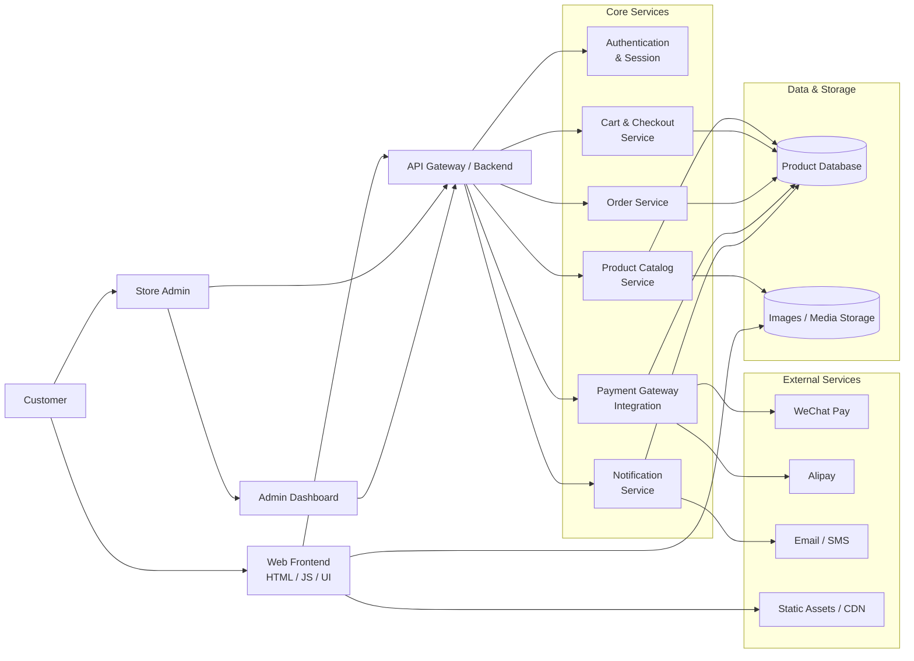

# Architecture Overview

This project is organized as a modern e-commerce MVP with a browser-based storefront, a modular backend, and payment/order processing capabilities.

## Components

- Web Frontend: storefront and shopping experience for customers.
- API Gateway / Backend: central entry point that routes requests to different services.
- Authentication: handles login, session management, and user identity.
- Product Catalog: manages product inventory, categories, and listings.
- Cart & Checkout: calculates totals, validates orders, and prepares checkout sessions.
- Order Service: creates and tracks orders after successful purchase.
- Payment Gateway Integration: connects to WeChat Pay and Alipay for secure transactions.
- Notification Service: sends order updates, confirmations, and alerts.
- Data Layer: stores product, order, payment, and user-related information.
- External Integrations: payment platforms and messaging channels.

## Typical Flow

1. User browses products in the web frontend.
2. Frontend calls the API gateway for catalog, cart, and checkout data.
3. Order creation is validated and sent to the order service.
4. Payment service initiates a payment request to WeChat Pay or Alipay.
5. Order status and user notifications are updated after payment confirmation.
6. Admin can review activity and manage operations through the admin dashboard.
